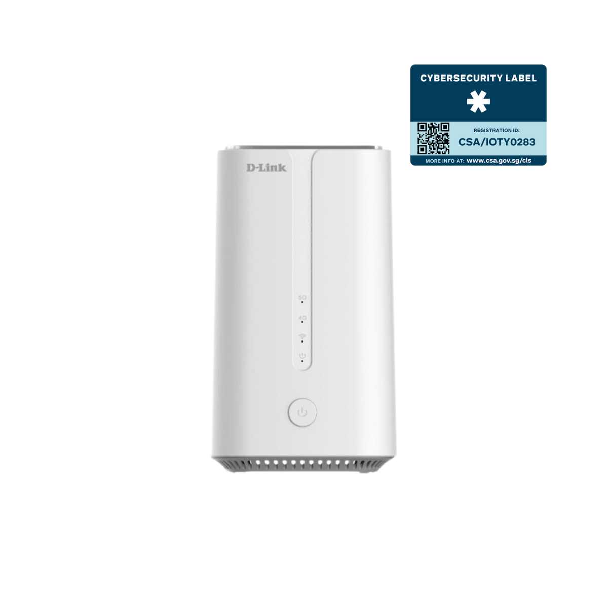

# OpenWrt 24.10 for D-Link DWR-2000M A3 (MediaTek MT6890)

  

This wiki is the long-form companion to the [repository](https://github.com/Mr-JoE1/openwrt-mt6890). It covers the
reverse-engineering analysis of the D-Link DWR-2000M A3 5G CPE, the procedure for flashing the image safely, and
lessons from the port that apply to other vendor-kernel devices.

## TL;DR

The DWR-2000M A3 is a MediaTek MT6890 (T750) 5G router whose vendor firmware is OpenWrt 19.07 on a heavily patched
Linux 4.19.205 kernel. This project keeps that kernel, the modem firmware and the bootloaders untouched. It builds
an **OpenWrt 24.10.8 userspace** as a regular source target whose kernel step is a no-op, ships the 136 stock kernel
modules in the rootfs, and produces a **rootfs-only 64 MiB UBI image**. That image is installed into the **inactive
A/B slot**. The boot record is switched last, and the preloader falls back to the untouched slot if the new one
doesn't boot. Cellular data (`proto mtkmipc`), Wi-Fi (`mtwifi` handler over the stock MT7915 stack) and A/B sysupgrade
with a boot-OK tries reset are implemented and covered by 243 mocked tests.

## Status

| | |
|---|---|
| Analysis | Done ([Porting Analysis](Porting-Analysis)) |
| Image build | Done, artefact verified (factory image sha256 `d2fd085c…`, 64 MiB UBI, 136/136 modules, ships armed) |
| Flash script v2.2 | Readable colorized output + final summary box (issue #5); raw sha256 `48b05e64…` of `scripts/dwr2000m-flash.sh` |
| Packages | `mt6890-mtkmipc` 51/51 · `mt6890-mtkwifi` 72/72 · `mt6890-sysupgrade` 120/120 mocked tests |
| On-device flash | **Pending.** Nothing has been flashed to hardware yet. The [Flash Plan](Flash-Plan) is ready. |

## Pages

| Page | What it covers |
|---|---|
| [Porting Analysis](Porting-Analysis) | Kernel provenance, the full 136-module inventory, DTB and memory map, kernel-config delta against 24.10, the A/B boot record, MIPC protocol findings, UCI migration, design decisions and the risk register |
| [Flash Plan](Flash-Plan) | Step-by-step stock → 24.10 install into slot A, with read-back gates, success criteria and rollback |
| [Lessons](Lessons) | What the port taught: no-op kernel targets, vendor-library discovery, UBI geometry, MIPC reverse-engineering, CID-tracked teardown, the tries counter, and process notes |

## Quick facts

| | |
|---|---|
| SoC | MediaTek MT6890 (T750), 4× Cortex-A55 |
| RAM | 1 GiB |
| Wi-Fi | MT7915 DBDC on PCIe (`ra0` 2.4 GHz, `rai0` 5 GHz), proprietary `mt_wifi` |
| Flash | Raw NAND, 49 PMT partitions, UBI PEB 256 KiB / LEB 253,952 B |
| Kernel | stock 4.19.205 (kept) |
| Userspace | OpenWrt 24.10.8 |
| Target | `mt6890` / subtarget `vk419` / device `dlink_dwr-2000m-a3` |

## Author

Maher. Released under the MIT license.
