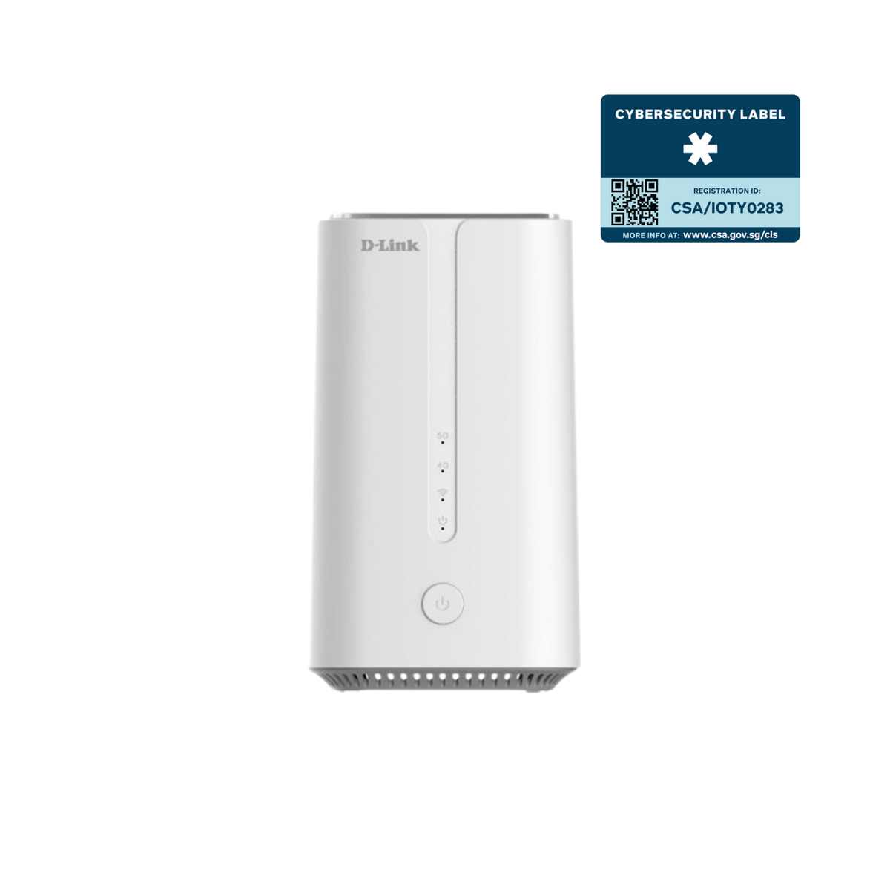

# OpenWrt 24.10 for D-Link DWR-2000M A3 (MediaTek MT6890)

<p align="center">
  
</p>

<p align="center">
  <a href="https://www.dlink.com.sg/products/dwr-2000m-5g-ax3000-wi-fi-6-telephony-router"><b>Product page (D-Link)</b></a>
  &nbsp;·&nbsp;
  <a href="https://dlinkmea.com/index.php/product/details?det=K1o4UkpXMHIreWZYMzhnV0JpbWFadz09">Product page (D-Link MEA)</a>
  &nbsp;·&nbsp;
  <a href="https://github.com/Mr-JoE1/openwrt-mt6890/wiki">Wiki</a>
</p>

An OpenWrt 24.10 target for the D-Link DWR-2000M hardware revision A3, a 5G CPE built on the MediaTek MT6890
(Dimensity T750) SoC. It replaces the vendor's OpenWrt 19.07 userspace with OpenWrt 24.10 and keeps the vendor
kernel, modem firmware and bootloaders exactly as shipped.

> **TL;DR**
> - **Kernel:** the stock vendor **Linux 4.19.205** kernel is left untouched. Nothing in the boot chain is rebuilt or re-flashed.
> - **Userspace:** **OpenWrt 24.10.8**, built from source as a regular `target/linux/mt6890` target.
> - **Image:** a **rootfs-only, 64 MiB UBI image** (squashfs `rootfs` + UBIFS `rootfs_data`), the same geometry as the stock rootfs slot.
> - **Upgrades:** **A/B sysupgrade** writes only the inactive slot and switches the boot record last. The preloader **falls back automatically** to the other slot if the new one fails to boot.

---

## Hardware

Values come from the stock firmware, the live device tree and the stock UBI images (see the
[Porting Analysis](https://github.com/Mr-JoE1/openwrt-mt6890/wiki/Porting-Analysis) §1–§3).

| Item | Value |
|---|---|
| SoC | MediaTek **MT6890** (T750), 4× Arm Cortex-A55, DT compatible `mediatek,evb6890v1_64_cpe_nand`, `mediatek,mt6890` |
| RAM | 1 GiB DRAM (live FDT `/memory` reg `0x4000_0000` + `0x4000_0000`); large modem and Wi-Fi offload carve-outs are reserved |
| Modem | Integrated 5G NR / LTE modem (MD1), driven by the built-in CCCI/CCMNI stack; vendor SDK lineage: Quectel RG500L / T750 |
| Wi-Fi | MediaTek **MT7915** DBDC (2.4 GHz `ra0` + 5 GHz `rai0`) on PCIe, proprietary `mt_wifi.ko` driver with WED/WO offload |
| PCIe | 4 Gen3 root ports (`mediatek,mt6880-pcie`, `PCIE_MEDIATEK_GEN3`); devices seen on the unit: MT7915 `14c3:7915` and `14c3:4d75` (reported as the MT7531 switch) |
| Ethernet / switch | `mediatek,mt6890-eth` with a `mediatek,mt753x` GSW (MT7531 family, swconfig, port map `llllw`), 2500base-x CPU link, SGMII second MAC |
| Flash | Raw NAND on the MTK NFI (`mediatek,mt6880-nfc`, MTK "nandx" driver), **49 MTD partitions** from the MTK PMT table |
| UBI geometry | PEB 262,144 B (256 KiB), VID header @ 4096, data @ 8192, **LEB 253,952 B**; rootfs slot = 256 PEB = 64 MiB |
| A/B layout | `rootfs_a` = mtd29, `rootfs_b` = mtd42, `misc` = mtd3 (boot record @ 2048, magic `00 41 42 30`, 4 copies, 256 KiB stride), `user_data` = mtd48 |
| Kernel | `4.19.205 #0 SMP Fri Nov 1 2024 aarch64`, `MODVERSIONS=y`, vermagic `4.19.205 SMP mod_unload modversions aarch64` |
| Kernel modules | **136** stock `.ko` (1 proprietary, 8 MTK out-of-tree, 127 open), plus ~41 built-ins |
| Console | UART `ttyS0` 921600 8N1 |

## What works

All functionality is covered by host-side mocked test suites that run the real shell code against a stubbed
`mipc_wan_cli`, `datconf`/`wifi`, `dd-nand`, `mtd` and `ubiattach`, plus OpenWrt's own netifd/jshn helpers.

| Feature | Implementation | Mocked tests |
|---|---|---|
| **Cellular WAN** | netifd protocol `proto mtkmipc` ([`package/mt6890-mtkmipc`](package/mt6890-mtkmipc)), drives the stock `mipc_wan_cli` (MIPC over `/dev/ttyCMIPC*`), CID-tracked teardown, secondary PDN, auto APN | **51 / 51** |
| **Wi-Fi** | netifd wireless handler `mtwifi` ([`package/mt6890-mtkwifi`](package/mt6890-mtkwifi)): renders UCI into the stock `.dat` profiles and drives the stock vendor Wi-Fi stack (`mt_wifi` + Lua `/sbin/wifi`) | **72 / 72** |
| **A/B sysupgrade** | `platform.sh` + `mt6890-bootctl` ([`package/mt6890-sysupgrade`](package/mt6890-sysupgrade)): inactive-slot write, UBI attach verification, boot record switched last, stock-UCI migration | **89** of 120 |
| **Boot-OK** | `/etc/init.d/mt6890-bootok`: resets the running slot's tries counter after a good boot | **31** of 120 |
| **Image** | squashfs + UBIFS UBI container, 136/136 stock modules hash-verified inside the image (`scripts/verify-image.py`) | PASS |

Total: **243 mocked test cases, 0 failures.**

Not covered: no LuCI views for `mtkmipc`/`mtwifi` yet, a single active SIM (secondary PDN only), no nl80211 (`iw`/`hostapd` don't apply to `mt_wifi`),
fw3 + `iptables-legacy` instead of fw4/nftables (the vendor kernel has no `NF_TABLES`).

## Architecture

### The no-op kernel design

The vendor kernel can't be rebuilt from OpenWrt sources. The stock modules import symbols that exist only in the vendor
vmlinux (HNAT/PPE hooks `ppe_hook_*`, `ra_sw_nat_hook_*`, the CCCI modem API `mtk_ccci_*`, conninfra, EMI-MPU), and
`MODVERSIONS=y` CRC-checks every one of them. The modem transport (CCCI, CCMNI, DPMAIF) is built into vmlinux and has no
mainline equivalent. So:

1. **The boot partitions stay stock.** `boot_a`/`boot_b` (Android v2 boot image: 4.19.205 kernel + DTB), preloader, LK,
   TEE and all modem partitions are never written.
2. **The target builds headers only.** `target/linux/mt6890` declares `KERNEL_PATCHVER:=6.6` so the 24.10 toolchain and
   `linux-headers` build. The 6.6 kernel is never installed or packaged; the device recipe sets `KERNEL :=` empty.
3. **The 136 vendor modules ship in the rootfs.** A local `vendor-kernel-4.19.205` package installs them with their
   stock autoload order and `Provides: kernel (=4.19.205)`, plus `kmod-*` stubs for the built-ins, so 24.10 package
   dependencies resolve. Official 24.10 kmods (vermagic 6.6) are never installed.
4. **Kernel feature gaps are matched in userspace:** fw3 + `iptables-legacy` (no `NF_TABLES`), swconfig (no DSA),
   no `procd-ujail`/`procd-seccomp` (no namespaces/seccomp), a custom Wi-Fi handler (no cfg80211).
5. **The image is rootfs-only.** One file, written to one slot.

Because the kernel is a no-op, a full image build takes a fraction of the time of a normal OpenWrt target, and the
port avoids the biggest risk: a self-built kernel that doesn't boot.

### UBI / flash layout

```
mtd3   misc        A/B boot record @2048: magic 00414230, A{prio,tries,success,uptype} B{...}, ×4 copies @256 KiB
mtd27  boot_a      stock kernel + DTB (untouched)       mtd40  boot_b      (untouched)
mtd28  rootfs_sig_a stock signature (untouched)          mtd41  rootfs_sig_b (untouched)
mtd29  rootfs_a    ← 64 MiB UBI written by this port     mtd42  rootfs_b    ← or this one (the inactive slot)
         vol 0  rootfs       squashfs-xz → /dev/ubiblock0_0 (OpenWrt 24.10 + 136 stock modules)
         vol 1  rootfs_data  UBIFS overlay (formatted on first boot)
mtd48  user_data   shared vendor data (untouched)
```

Upgrade order: write the inactive `rootfs_X` → `ubiattach` must find `rootfs` + `rootfs_data` → store the config in the new
slot's `rootfs_data` → only then write the boot record (target priority `0f`, tries `03`, other slot `0e`) to all four copies
with read-back → reboot. If the new slot doesn't come up, the preloader's tries counter falls back to the other slot.
`mt6890-bootok` zeroes the running slot's tries byte on every good boot, so a healthy slot never falls back.

## Quickstart

You need your **own** stock firmware dump from a DWR-2000M A3: the stock module tarball and an extracted stock rootfs.
No vendor binaries are distributed here.

The scripts expect this working layout (all of it git-ignored):

```
openwrt-mt6890/                 this repository
├── openwrt/                    OpenWrt v24.10.8 checkout
├── evidence/modules-4.19.205.tgz   stock /lib/modules/4.19.205 tarball from your unit
└── build/
    ├── modules-extracted/modules/4.19.205/   the same tarball, extracted (pin reference)
    └── rootfs_a-full/          your unit's full stock rootfs (tar of / over SSH, or unsquashfs of the rootfs UBI vol 0)
```

```sh
# 1. This repository + OpenWrt 24.10.8
git clone https://github.com/Mr-JoE1/openwrt-mt6890.git && cd openwrt-mt6890
git clone https://git.openwrt.org/openwrt/openwrt.git && git -C openwrt checkout v24.10.8
(cd openwrt && ./scripts/feeds update -a && ./scripts/feeds install -a)

# 2. Apply this target tree
cp -r target/linux/mt6890 openwrt/target/linux/
cp -r package/mt6890-*    openwrt/package/

# 3. Import the stock vendor modules and files from your own dump (sha256-pinned)
scripts/import-stock.sh -p all -s build/rootfs_a-full

# 4. Build
cd openwrt
make menuconfig     # Target: MediaTek MT6890 (T750) → Vendor 4.19 kernel → D-Link DWR-2000M A3
make -j"$(nproc)"
cd ..

# 5. Verify the artefact (UBI geometry, 136/136 module hashes, A/B guard)
python3 scripts/verify-image.py
```

`import-stock.sh` refuses to install anything if a module's sha256 doesn't match the pinned value, and it never imports
stock init or upgrade scripts. Two things are not in this release yet. (1) The four local vendor package recipes
(`openwrt/package/vendor/{vendor-kernel-4.19.205,vendor-modem-stack,vendor-mtwifi-fw,vendor-compat-libs}/Makefile`)
that the import step fills. (2) A small change to OpenWrt's generic `include/image.mk` that skips the kernel-image
existence check when a device sets an empty `KERNEL` (see [Lessons](https://github.com/Mr-JoE1/openwrt-mt6890/wiki/Lessons)).

Output: `openwrt/bin/targets/mt6890/vk419/openwrt-mt6890-vk419-dlink_dwr-2000m-a3-squashfs-factory-rootfs.bin` (64 MiB) and
`...-squashfs-sysupgrade.tar`. Read the [Flash Plan](https://github.com/Mr-JoE1/openwrt-mt6890/wiki/Flash-Plan)
before writing anything to a device.

Run the test suites. They need an OpenWrt tree that has built its host tools (`jshn`, netifd scripts, uci source):

```sh
export OPENWRT_TOP=$PWD/openwrt
sh package/mt6890-mtkmipc/tests/run.sh       # 51 cases
sh package/mt6890-mtkwifi/tests/run.sh       # 72 cases
sh package/mt6890-sysupgrade/tests/run.sh    # 120 cases
```

## Repository layout

| Path | Contents |
|---|---|
| [`target/linux/mt6890/`](target/linux/mt6890) | Target `Makefile` (headers-only 6.6), `vk419` subtarget, image recipe (rootfs-only UBI), base-files (board.d LEDs/network, inittab, mtd links, defaults) |
| [`package/mt6890-mtkmipc/`](package/mt6890-mtkmipc) | netifd protocol `mtkmipc` for the integrated 5G modem + tests |
| [`package/mt6890-mtkwifi/`](package/mt6890-mtkwifi) | netifd wireless handler `mtwifi` for the stock MT7915 stack + default `/etc/config/wireless` + tests |
| [`package/mt6890-sysupgrade/`](package/mt6890-sysupgrade) | A/B `platform.sh`, `mt6890-bootctl`, `mt6890-bootok`, stock→24.10 UCI migration + tests |
| [`scripts/import-stock.sh`](scripts/import-stock.sh) | Populates the local-only `package/vendor/*` from your own stock dump, sha256-pinned |
| [`scripts/verify-image.py`](scripts/verify-image.py) | Offline artefact verifier: UBI headers/volume table, squashfs extraction, module hashes, sysupgrade tar |
| [`scripts/ab_guard.sh`](scripts/ab_guard.sh) | Build guard: fails if a stock slot-cloning script survives into the rootfs |
| [`docs/images/`](docs/images) | Product image |
| [Wiki](https://github.com/Mr-JoE1/openwrt-mt6890/wiki) | [Porting Analysis](https://github.com/Mr-JoE1/openwrt-mt6890/wiki/Porting-Analysis) · [Flash Plan](https://github.com/Mr-JoE1/openwrt-mt6890/wiki/Flash-Plan) · [Lessons](https://github.com/Mr-JoE1/openwrt-mt6890/wiki/Lessons) |

## Status

| Stage | State |
|---|---|
| Hardware and firmware analysis | Done |
| Target tree, vendor import, full image build | Done |
| Cellular, Wi-Fi, A/B sysupgrade, bootok packages | Done, mocked tests 243/243 |
| Image artefact verification | **PASS**: final factory image sha256 `065c67d7…` (64 MiB UBI, 136/136 modules) |
| On-device flash | **Pending.** The image has not been flashed to hardware yet. |

Open questions that only hardware can answer: whether LK accepts a modified rootfs with the stock `rootfs_sig`, the
preloader's exact tries threshold, and LK's `ubi.mtd=` rewrite for slot A. All three fail closed: the unit boots the
untouched stock slot. Details are in the [Flash Plan](https://github.com/Mr-JoE1/openwrt-mt6890/wiki/Flash-Plan).

## Why this exists

5G CPEs like this one ship with capable hardware (a quad-core SoC, an integrated 5G modem, AX3000 Wi-Fi) and a
userspace that stops getting updates long before the hardware wears out. Moving the userspace to a current OpenWrt
while keeping the vendor kernel and modem firmware lets these units stay useful and patched instead of ending up as
e-waste. If you own a similar MT6890 / T750 device, the design here (no-op kernel, rootfs-only A/B image, MIPC proto)
should carry over with board-specific changes. Contributions and hardware reports are welcome.

## Credits

The integration approach follows the public design documentation of the ZLT X28 OpenWrt project, an MT6890 CPE from the
same SDK family. All code here is an independent implementation.

## License

MIT, see [LICENSE](LICENSE). Shell and Makefile sources carry `SPDX-License-Identifier: GPL-2.0-only` headers where they
follow OpenWrt conventions. Vendor binaries (kernel modules, firmware, modem userspace) are **not** part of this
repository and keep their original licenses.

**Author: Maher**
